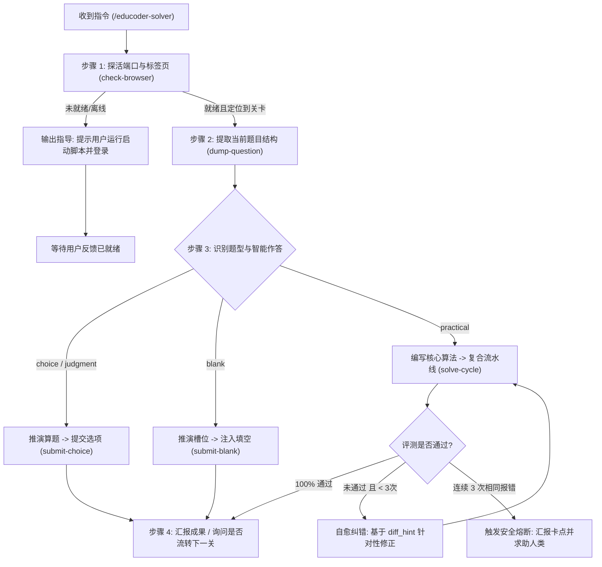

# 头歌自动答题与实训接管专家 (Educoder Solver Skill)

本 Skill 赋能 AI Agent 直接接管并操作用户已登录的头歌（Educoder）物理浏览器，形成**“感知 -> 推演 -> 复合流水线作答 -> 低熵自愈 -> 关卡流转”**的完整全自动答题闭环。

---

## 核心工作哲学与三层边界

1. **大脑与手眼分离**：你（AI）是大脑，负责语义理解、算法编写与自愈纠错；本地 CLI 工具（`python -m src.cli`）是手眼，负责精准执行浏览器交互。
2. **纯本地决策**：严禁调用任何外部第三方商业大模型 API，所有题目的推演、解题思路与代码编写均由你直接生成。
3. **低熵输出与信息提纯**：严禁向大模型吐出未经清洗的大段 DOM/HTML 杂音，所有评测输出均由底层提纯为高密度的 `expected`, `actual`, `diff_hint`，全面保护 AI 思考题目的心智带宽。
4. **安全防风控与健壮交互**：
   - 操作前**必须探活** 9222 调试端口；
   - 交互前**自动清理**弹窗与遮罩；
   - 评测采用**两阶段防竞态监听**，杜绝过早读取上一关历史结果；
   - 严禁死循环评测：连续 3 次相同报错即触发熔断，主动向用户汇报并暂停。

---

## 执行标准作业流程 (SOP)

当用户输入 `/educoder-solver [用户指令]`（例如：`/educoder-solver 帮我自动完成当前头歌实验` 或 `/educoder-solver 做这道题`）时，按以下四步顺序坚决执行：



---

### 步骤 1：前置探活与用户协同

在当前项目虚拟环境下执行浏览器探活命令（务必附带 `--json`）：

```powershell
.\.venv\Scripts\python -m src.cli check-browser --json
```

- **分支 A (离线 / 无头歌页面)**：
  如果返回 `"cdp_available": false` 或 `"has_educoder_page": false`，**切勿盲目重复调用命令**，立即向用户输出清晰友好的三步指引：
  > 💡 **请先启动调试浏览器并登录关卡**：
  > 1. 打开终端运行脚本：`.\scripts\launch_browser.ps1`（或双击运行 `scripts\launch_browser.bat`）；
  > 2. 在弹出的浏览器窗口中登录您的头歌账号，并进入待作答的实验关卡页面；
  > 3. 准备好后请回复我，我将立即为您继续自动作答。

- **分支 B (在线就绪)**：
  如果返回 `"cdp_available": true` 且匹配到 Educoder 标签页，向用户简要确认当前关卡标题，并直接推进到步骤 2。

---

### 步骤 2：题目感知与提取

执行题目提纯命令：

```powershell
.\.venv\Scripts\python -m src.cli dump-question --json
```

系统将返回标准化的 `QuestionData` JSON。你需要提取并关注：
- `type`: 题目类型（`choice`, `multiple_choice`, `judgment`, `blank`, `practical`）
- `title` 与 `description`: 题干要求与背景上下文
- `options` / `blanks` / `practical_details`: 题型专属数据

---

### 步骤 3：根据题型推演并下发动作

#### 场景 3.1：客观选择题与判断题 (`choice` / `multiple_choice` / `judgment`)
1. **AI 独立推理**：仔细阅读题干与全部选项文本，运用你的知识库推导正确答案（如单选题选 `A`，多选题选 `A,C`，判断题选 `正确` / `错误`）。
2. **向用户输出简明解析**：简要说明为什么选该项，展现专业可靠的解题过程。
3. **下发点击指令**：
   ```powershell
   .\.venv\Scripts\python -m src.cli submit-choice --options A,C --json
   ```
   *(注：底层已内置防反选保护，多选题即便重复勾选也不会误取消)*

#### 场景 3.2：文本填空题 (`blank`)
1. **分析槽位**：结合每个空位的前后文（`prefix_text`, `suffix_text`）和提示（`hint`），推导各槽位要填写的准确字词或代码表达式。
2. **下发填空指令**：
   ```powershell
   .\.venv\Scripts\python -m src.cli submit-blank --answers '["答案一", "答案二"]' --json
   ```

#### 场景 3.3：编程实训题 (`practical`)
1. **解析核心要求**：
   - 仔细阅读 `practical_details.task_description`（任务要求与算法目标）；
   - 查看 `sample_io`（输入输出测试用例样例）；
   - 审阅 `prefix_code` 与 `suffix_code`，确认待编写的靶心算法区域（`Begin - End` 之间），明确入参、返回值类型及编程语言（Python / C++ / Java / SQL 等）。
2. **生成靶心代码**：
   - 编写高鲁棒性、处理边界情况的核心实现；
   - 保持正确的缩进层级（通常为 4 空格）；
   - **绝不要**将不可变的外围 `prefix_code` 或 `suffix_code` 重复写在靶心代码中。
3. **极速闭环注入与评测 (强烈推荐复合流水线)**：
   ```powershell
   .\.venv\Scripts\python -m src.cli solve-cycle --code "<你的核心代码>" --json
   ```
   *(注：单次调用自动完成【清理遮罩 -> Monaco安全注入 -> 两阶段防竞态评测 -> 高密度Diff提取】，耗时由 30s 缩减至 5~8s)*
   *（亦可分步调用 `inject-code` 与 `trigger-eval`）*
4. **处理评测反馈（自愈回路）**：
   - 若 `passed: true`：评测全绿通过！向用户通报胜利成果。
   - 若 `passed: false`：查看回执中的 `diff_hint`（高信息密度差异分析）、`expected`、`actual` 与 `error_msg`。进入自愈修复：
     - 分析是断言不匹配（如大小写、末尾空行、行数不匹配）还是运行时异常；
     - 调整算法并重新执行 `solve-cycle`；
     - **熔断红线**：若同一道题目连续 3 次返回完全一样的报错（`circuit_broken == true`），**必须立即停止重复评测**，向用户展示当前卡点与代码，征询用户意见。

---

### 步骤 4：关卡流转与总结

1. 一关顺利完成后，向用户报告作答总结（题目、推导答案、评测通过率）。
2. 若用户指示了连续答题或自动下一关，可直接在流水线中开启 `--auto-next`：
   ```powershell
   .\.venv\Scripts\python -m src.cli solve-cycle --code "<代码>" --auto-next --json
   ```
   或分步调用：
   ```powershell
   .\.venv\Scripts\python -m src.cli trigger-eval --auto-next --json
   ```
   自动点击平台上的“下一关”按钮进入后续关卡。

---

## 进阶参考手册

若需要查阅底层 CLI 的参数签名、JSON 契约格式或 Monaco 注入细节，可随时查阅项目内的完整操作手册：
- [docs/AI_MANUAL.md](file:///e:/项目/tou%20ge/docs/AI_MANUAL.md)
- [references/ai_manual.md](references/ai_manual.md)
