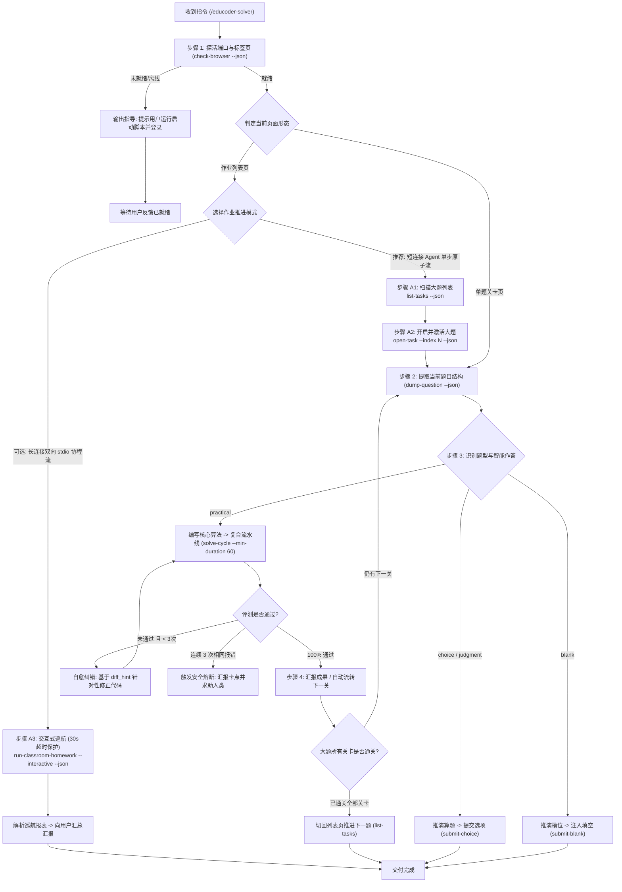

# 头歌自动答题与实训接管专家 (Educoder Solver Skill v3)

本 Skill 赋能 AI Agent 直接接管并操作用户已登录的头歌（Educoder）物理浏览器，形成**“感知 -> 推演 -> 控速防刷 -> 复合流水线作答 -> 双轨评测自愈 -> 课堂大作业巡航”**的完整全自动答题闭环。

---

## 核心工作哲学与铁律边界

1. **大脑与手眼分离**：你（AI）是大脑，负责语义理解、算法编写与自愈纠错；本地 CLI 工具（`python -m src.cli`）是手眼，负责精准执行浏览器交互。
2. **纯本地决策**：严禁调用任何外部第三方商业大模型 API，所有题目的推演、解题思路与代码编写均由你直接生成。
3. **课堂大作业官方命令链准则**：若检测到处于课堂实训作业列表页，一问一答型短连接 AI Agent **强烈推荐单步原子流（`list-tasks` -> `open-task` -> `solve-cycle`）**；具备实时双向 stdio 通信环境方可使用 `run-classroom-homework --interactive`；严禁私自手写未经封装的临时 Python 脚本操作 Tab。
4. **防秒刷控速硬性规范 (Anti-Cheat Pacing)**：单关作答必须执行智能思考控速（默认 `--min-duration 60` 配合 `5~20s` 离散浮动），开题打卡差额补足，配合微滚动活跃心跳，严禁秒刷触发教师端作弊审查。
5. **低熵输出与信息提纯**：题干中的 `<table>` 必须转为 Markdown 表格，图片剔除 base64 噪音，评测回执收敛为高密度 `diff_hint`，全面保护 AI 思考题目的心智带宽。
6. **两阶段防竞态与安全熔断**：双轨评测监听（网络层优先 + DOM 兜底校验 `\d+S` 倒计时与 `_has_real_result`）；连续 3 次相同报错强制熔断报警。

---

## 执行标准作业流程 (SOP)

当用户输入 `/educoder-solver [用户指令]`（例如：`/educoder-solver 帮我自动完成当前头歌实验`、`/educoder-solver 把这门课的作业全跑完` 或 `/educoder-solver 做这道题`）时，按以下状态机执行：



---

### 步骤 1：前置探活与页面形态研判

在当前项目虚拟环境下执行浏览器探活命令（务必附带 `--json`）：

```powershell
.\.venv\Scripts\python -m src.cli check-browser --json
```

- **分支 1.1 (离线 / 无头歌页面)**：
  如果返回 `"cdp_available": false` 或 `"has_educoder_page": false`，**切勿盲目重复调用命令**，立即向用户输出清晰友好的三步指引：
  > 💡 **请先启动调试浏览器并登录关卡**：
  > 1. 打开终端运行脚本：`.\scripts\launch_browser.ps1`（或双击运行 `scripts\launch_browser.bat`）；
  > 2. 在弹出的浏览器窗口中登录您的头歌账号，并进入待作答的课堂作业列表或实验关卡页面；
  > 3. 准备好后请回复我，我将立即为您继续自动作答。

- **分支 1.2 (在线就绪 - 课堂作业列表页)**：
  如果页面标题或 URL 包含 `classrooms`, `homeworks`, `shixuns`，且包含多个实训大题卡片，**直接跳转至【场景 A：课堂作业推进工作流】**。

- **分支 1.3 (在线就绪 - 单题关卡页)**：
  如果已处于具体题目的作答页面，推进到步骤 2。

---

### 场景 A：课堂作业推进工作流 (Classroom Homework Workflow)

#### 模式 A1：短连接 Agent 单步原子流 (强烈推荐，一问一答型 AI 首选)
现代 Agent 环境的 CLI 执行工具（如 `run_command`）属于短周期阻塞调用，无法在单次执行中途双向交互。因此**单步原子流是百分之百稳健、无死锁的黄金解法**：

1. **只读扫描大题列表**：
   ```powershell
   .\.venv\Scripts\python -m src.cli list-tasks --json
   # 若打开了多个标签页，可加 --match 精确匹配：
   .\.venv\Scripts\python -m src.cli list-tasks --match homework --json
   ```
   返回干净的 JSON 数据，展示大题总数、待完成列表与按钮可用状态。

2. **单步开启指定大题**：
   ```powershell
   # 默认自动开启第 1 个未完成的大题并激活新 Tab
   .\.venv\Scripts\python -m src.cli open-task --json
   # 或显式指定大题序号 (0-indexed)：
   .\.venv\Scripts\python -m src.cli open-task --index 1 --json
   ```
   底层自动点击卡片按钮、等待捕获新标签页并将其聚焦置顶（`bring_to_front`），清除阻断遮罩后返回第 1 关的题型与概要信息。

3. **关卡内闭环推进**：
   此时浏览器焦点已切换到该大题关卡，直接调用单关流程：
   - 提取题目：`.\.venv\Scripts\python -m src.cli dump-question --json`
   - 推演算法并通过复合流水线注入作答：
     ```powershell
     .\.venv\Scripts\python -m src.cli solve-cycle --code "<你的核心代码>" --auto-next --min-duration 60 --json
     ```
   - 关卡评测全绿并通过 `--auto-next` 进入下一关；重复此步直至整道大题所有关卡通关。

4. **推进下一道大题**：
   一道大题通关后，再次执行 `list-tasks --json` 检查进度，继续 `open-task --json` 进入下一道大题，直至全课程作业完成。

#### 模式 A2：长连接双向 stdio 协程流 (`run-classroom-homework --interactive`)
仅在你的环境支持长连接后台守护进程并具备持续向 stdin 写入 JSON Lines 通道时使用：
- **启动指令**：
  ```powershell
  .\.venv\Scripts\python -m src.cli run-classroom-homework --interactive --min-duration 60 --json
  ```
- **握手协议规范**：
  1. CLI 在开题后向 `stdout` 输出 JSON 事件：
     `{"event": "question_detected", "task_title": "...", "level_index": 1, "question_type": "practical", "question_data": {...}}`
  2. 外部控制器从 `stdin` 回复动作指令（内置 30s 超时看门狗保护，超时安全退出）：
     `{"action": "solve", "code": "SELECT 1;", "target_only": true}` 或 `{"action": "skip"}`
  3. CLI 触发评测并向 `stdout` 回传评测结果：
     `{"event": "eval_result", "passed": true, "diff_hint": "通过"}`
- **演练模式 (仅扫描列题不点击)**：
  ```powershell
  .\.venv\Scripts\python -m src.cli run-classroom-homework --dry-run --json
  ```

### 步骤 2：题目感知与 Markdown 表格提取

在具体关卡页面执行题目提纯命令：

```powershell
.\.venv\Scripts\python -m src.cli dump-question --json
```

系统将返回标准化的 `QuestionData` JSON：
- `type`: 题目类型（`choice`, `multiple_choice`, `judgment`, `blank`, `practical`）
- `description`: 题干（**已自动将 HTML `<table>` 转换为标准 Markdown 表格，图片已剔除 base64 转为 `[附图说明: xxx]`**）
- `practical_details`: 实训专属数据（任务要求、输入输出样例、`prefix_code` / `target_code` / `suffix_code` 靶心区域）

---

### 步骤 3：根据题型推演并下发动作

#### 场景 3.1：客观选择题与判断题 (`choice` / `multiple_choice` / `judgment`)
1. **AI 独立推理**：仔细阅读题干与选项文本，推导正确答案（如单选 `A`，多选 `A,C`，判断 `正确`）。
2. **下发点击指令**：
   ```powershell
   .\.venv\Scripts\python -m src.cli submit-choice --options A,C --json
   ```
   *(注：内置防反选保护，已勾选的选项自动跳过，绝不发生误取消)*

#### 场景 3.2：文本填空题 (`blank`)
1. **分析槽位**：结合空位前后文（`prefix_text`, `suffix_text`）和提示（`hint`），推导各槽位内容。
2. **下发填空指令**：
   ```powershell
   .\.venv\Scripts\python -m src.cli submit-blank --answers '["答案一", "答案二"]' --json
   ```

#### 场景 3.3：编程实训题 (`practical`)
1. **解析核心要求**：
   - 阅读 `task_description` 与题干中的 Markdown 表格（如数据表字段规范）；
   - 查看 `sample_io` 样例；
   - 审阅 `prefix_code` 与 `suffix_code`，确认待编写的靶心算法区域（`Begin - End` 之间）。
2. **生成靶心代码**：
   - 编写高鲁棒性、处理边界情况的核心实现，保持正确的缩进；
   - **绝不要**将外围 `prefix_code` 或 `suffix_code` 重复写在靶心代码中。
3. **极速闭环注入与控速评测 (强烈推荐复合流水线)**：
   ```powershell
   .\.venv\Scripts\python -m src.cli solve-cycle --code "<你的核心代码>" --min-duration 60 --json
   ```
   *(注：单次调用自动完成【清理遮罩 -> Monaco/Fiber 内存穿透注入 -> 60s智能差额控速与保鲜心跳 -> CDP网络层拦截优先双轨评测 -> 高密度Diff提取】)*
4. **处理评测反馈（自愈回路）**：
   - 若 `passed: true`：评测全绿通过！向用户通报通关。
   - 若 `passed: false`：查看回执中的 `diff_hint`、`expected`、`actual` 与 `error_msg`。
     - 调整算法并重新执行 `solve-cycle --min-duration 60 --json`；
     - **熔断红线**：若同一道题目连续 3 次返回完全一样的报错（`circuit_broken == true`），**必须立即停止重复评测**，向用户汇报当前卡点，请求人类协同介入。

---

### 步骤 4：关卡流转与总结

1. 一关顺利完成后，向用户汇报作答总结（题目、推导答案、评测通过率、耗时）。
2. 若用户要求连续答题，可在流水线中开启 `--auto-next`：
   ```powershell
   .\.venv\Scripts\python -m src.cli solve-cycle --code "<代码>" --auto-next --min-duration 60 --json
   ```
   自动点击平台上的“下一关”按钮进入后续关卡。

---

## 常见问题与避坑指南 (Troubleshooting)

| 典型场景与报错 | 根本原因 | 官方推荐处理手法 |
| :--- | :--- | :--- |
| **执行命令后进程假死/挂起** | 调用了 `run-classroom-homework --interactive`，但当前 Agent 的工具是单次短连接阻塞调用，无法在运行时输入 stdin | **切勿使用交互式巡航**。改用推荐的**单步原子流（模式 A1）**：`list-tasks` -> `open-task` -> `dump-question` -> `solve-cycle`。系统已内置 30s 看门狗超时保护，超时会自动释放。 |
| **扫描结果为 0 道大题 / 静默空跑** | 浏览器停留在 `/classrooms` 班级总览页而非具体的作业列表页，或者打开了多个不相关标签页 | 执行命令时显式加上 `--match` 参数精确匹配目标 URL，例如：`list-tasks --match homework --json` 或让用户点进课程作业列表。 |
| **实训题评测报错提示代码为空** | 关卡中缺少靶心代码标记，或未传入解题算法 | 系统已加入靶心空代码拦截保护，不再拿空白模板盲目评测。请先 `dump-question` 观察题干与靶心区域，再通过 `solve-cycle --code "<代码>"` 正确下发解题逻辑。 |
| **不知道如何连续刷完整门课作业** | 以为必须手写临时脚本切换 Tab | **严禁手写任何临时脚本**！官方原生支持单步推进：每做完一个大题的全部关卡，直接再次执行 `list-tasks --json` 检查进度并 `open-task --json` 进入下一道大题。 |

---

## 进阶参考手册

若需要查阅底层 CLI 的参数签名、JSON 契约格式、控速算法或 Monaco 注入细节，可随时查阅项目内的完整操作手册：
- [docs/AI_MANUAL.md](file:///e:/项目/tou%20ge/docs/AI_MANUAL.md)
- [references/ai_manual.md](references/ai_manual.md)

