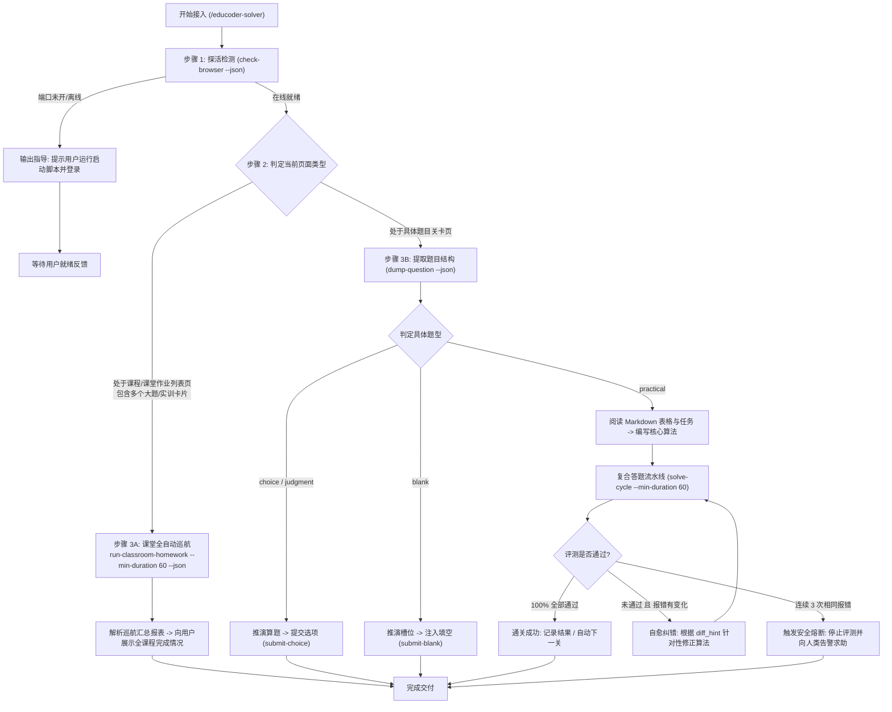

# 头歌自动答题系统 - 面向 AI 代理的操作手册 (AI Manual)

> **版本**：v3.0.0  
> **适用对象**：本地大型语言模型 / Agentic AI（如 Antigravity、Claude Code、Cursor 等本地执行代理）  
> **核心原则**：纯本地推理、零商业 API 依赖、真机 CDP 拟真交互、防秒刷控速、低熵提纯、大作业自动化巡航、防封号防死循环

---

## 1. 代理核心定位与工作流

你（AI 代理）在此系统中担任**“认知推演大脑”**，系统提供的 Python CLI 工具（`src.cli`）充当你的**“感知眼与执行手”**。

### 1.1 智能双层决策树 (Decision Tree)

在面对头歌平台时，你首先探查当前页面处于**“课堂作业列表页”**还是**“单题关卡页”**，据此走不同的调度链路：



---

## 2. CLI 接口标准调用规范

所有 CLI 命令在由 AI 代理调用时，**必须且强制附带 `--json` 参数**。系统将把结构化数据输出到 `stdout`，人类可读日志输出到 `stderr`，确保你的 JSON 解析绝无污染。

运行环境：项目根目录下的 `.venv` 虚拟环境。  
Windows 推荐执行命令前缀：`.\.venv\Scripts\python -m src.cli`

---

### 2.1 浏览器与标签页探活 (`check-browser`)

用于在任何答题操作前探查本地 9222 端口及头歌页面。

```powershell
.\.venv\Scripts\python -m src.cli check-browser --json
```

#### JSON 输出契约
- **正常在线** (Exit Code 0)：
  ```json
  {
    "status": "online",
    "cdp_available": true,
    "host": "127.0.0.1",
    "port": 9222,
    "pages_count": 2,
    "has_educoder_page": true,
    "pages": [
      {
        "index": 0,
        "title": "课程作业列表 - 头歌教学平台",
        "url": "https://www.educoder.net/classrooms/xxxx/shixun_homeworks",
        "is_educoder": true
      }
    ]
  }
  ```
- **离线或端口未开** (Exit Code 1)：
  ```json
  {
    "status": "offline",
    "cdp_available": false,
    "host": "127.0.0.1",
    "port": 9222,
    "message": "CDP 远程调试端口 127.0.0.1:9222 未开启或未就绪"
  }
  ```

> **AI 动作指南**：
> 若 `cdp_available == false` 或 `has_educoder_page == false`，**切勿盲目重复调用**。立即向用户输出友好的引导提示，告知其运行 `.\scripts\launch_browser.ps1`，并在弹出的浏览器窗口中登录头歌。

---

### 2.2 课堂大作业全自动巡航 (`run-classroom-homework`) [v3 新增，课程作业首选]

当当前页面处于**课堂实训作业列表页**（URL 含 `classrooms`, `homeworks`, `shixuns`，且页面展示多道未完成实训大题）时，**直接使用此指令一键全自动巡航**。底层将自动执行：列表扫描 -> 过滤未完成 -> 新开 Tab -> 关卡推进 -> 控速等待 -> 双轨评测 -> 安全关闭 Tab -> 刷新列表 -> 推进下一题。

```powershell
# 标准巡航：连续推进待完成大题，每关控速 60 秒 (推荐)
.\.venv\Scripts\python -m src.cli run-classroom-homework --min-duration 60 --json

# 限制单次最多推进 3 道大题
.\.venv\Scripts\python -m src.cli run-classroom-homework --max-tasks 3 --min-duration 60 --json

# 快速自测模式 (min-duration 设为 0，直出不等待)
.\.venv\Scripts\python -m src.cli run-classroom-homework --min-duration 0 --json
```

#### JSON 输出契约
```json
{
  "status": "success",
  "total_tasks_found": 8,
  "tasks_processed": 3,
  "tasks_completed": 3,
  "tasks_skipped": 5,
  "tasks_failed": 0,
  "details": [
    {
      "task_name": "实训大题 #1 (表的操作与数据完整性)",
      "initial_status": "未完成",
      "final_status": "已完成",
      "levels_passed": 4,
      "success": true
    },
    {
      "task_name": "实训大题 #2 (多表连接查询)",
      "initial_status": "未完成",
      "final_status": "已完成",
      "levels_passed": 3,
      "success": true
    }
  ],
  "elapsed_seconds": 382.4
}
```

> **AI 行为准则**：
> **严禁**在此类页面手写临时 Python 脚本去逐个查找元素或操作 Tab！直接下发 `run-classroom-homework`，底层会自动处理好跨标签页生命周期并返回汇总报表。

---

### 2.3 提取当前页面题目 (`dump-question`) [含 Table2Markdown 表格提纯]

自动探测当前关卡题型，提纯题干、HTML 表格（已自动转为标准 Markdown 表格）、附件图片说明、选项与靶心代码骨架。

```powershell
.\.venv\Scripts\python -m src.cli dump-question --json
```

#### JSON 输出契约 (核心字段)
```json
{
  "type": "choice | multiple_choice | judgment | blank | practical | unknown",
  "title": "第1关：创建数据表并设置主键约束",
  "description": "#### 编程要求\n请根据下表在 MySQL 中创建 `tb_student` 表：\n\n| 字段名 | 数据类型 | 约束条件 |\n| --- | --- | --- |\n| sno | char(10) | 主键 |\n| sname | varchar(20) | 非空 |\n\n[附图说明: 表结构关系图.png]",
  "options": [],
  "blanks": [],
  "practical_details": {
    "task_description": "创建指定数据表 tb_student 并添加主键约束",
    "sample_io": "预期结果包含 tb_student 表结构定义",
    "eval_instructions": "系统将执行 show tables 及 describe tb_student 进行断言",
    "code": "# 请在下方编写 SQL 语句\n########## Begin ##########\n\n########## End ##########\n",
    "prefix_code": "# 请在下方编写 SQL 语句\n########## Begin ##########\n",
    "target_code": "\n",
    "suffix_code": "########## End ##########\n",
    "language": "sql",
    "has_target_marker": true,
    "editor_type": "monaco"
  }
}
```

> **Table2Markdown 关键收益**：
> 题干中的数据表已被完整转换为 Markdown 表格（如 `| 字段名 | 数据类型 | 约束条件 |`），图片被替换为结构化标注 `[附图说明: xxx]`，**绝无 base64 乱码污染**，你只需专注于推演 SQL 或算法。

---

### 2.4 复合答题流水线 (`solve-cycle`) [实训题单题首选，集成控速]

在单个 CDP 会话中一次性流转：**清理遮罩弹窗 -> Monaco/Fiber 内存级注入 -> 智能思考控速等待 -> CDP网络层拦截/DOM快照双轨评测 -> 高密度Diff提纯 -> (可选)流转下一关**。

```powershell
# 靶心模式注入并评测，默认 60s 拟真防刷控速 (推荐模式)
.\.venv\Scripts\python -m src.cli solve-cycle --code "CREATE TABLE tb_student (sno CHAR(10) PRIMARY KEY, sname VARCHAR(20) NOT NULL);" --min-duration 60 --json

# 全量替换代码并在全绿后自动点击“下一关”
.\.venv\Scripts\python -m src.cli solve-cycle --file "solution.sql" --full --auto-next --min-duration 60 --json

# 快速自测模式 (min-duration 0 直出放行)
.\.venv\Scripts\python -m src.cli solve-cycle --code "SELECT * FROM tb_emp;" --min-duration 0 --json
```

#### JSON 输出契约 (高密度低熵)
```json
{
  "success": true,
  "passed": false,
  "pass_ratio": "0/1",
  "expected": "sno char(10) PRI",
  "actual": "sno varchar(10) PRI",
  "diff_hint": "第 1 行内容不匹配: 预期包含 'char(10)' vs 实际 'varchar(10)'",
  "stdout_msg": "",
  "error_msg": "AssertionError: column type mismatch",
  "circuit_broken": false,
  "next_level_triggered": false,
  "overlays_dismissed": 1,
  "elapsed_seconds": 64.12,
  "injection": {
    "success": true,
    "method_used": "monaco_api",
    "backup_path": "E:/.../.cache/backups/backup_20261003.sql",
    "is_target_assembled": true
  },
  "message": "评测未通过 (通过率: 0/1)"
}
```

---

### 2.5 提交客观选择题/判断题 (`submit-choice`)

```powershell
# 单选或判断
.\.venv\Scripts\python -m src.cli submit-choice --options A --json
.\.venv\Scripts\python -m src.cli submit-choice --options 正确 --json

# 多选 (逗号分隔)
.\.venv\Scripts\python -m src.cli submit-choice --options A,C,D --json
```

*(内置防反选保护机制，已勾选的选项自动跳过，绝不会发生误取消)*

---

### 2.6 提交文本填空题 (`submit-blank`)

```powershell
.\.venv\Scripts\python -m src.cli submit-blank --answers '["答案一", "答案二"]' --json
```

*(自动派发 `input`、`change`、`blur` 原生事件，确保数据双向绑定并持久化)*

---

### 2.7 分步注入编程实训题代码 (`inject-code`)

```powershell
# 靶心注入
.\.venv\Scripts\python -m src.cli inject-code --code "    return sum(nums) / len(nums)" --json

# 全量注入
.\.venv\Scripts\python -m src.cli inject-code --file ./solution.py --full --json
```

*(内置快照自动备份至 `.cache/backups/`，且优先穿透 Monaco/Ace 及 React/Vue Fiber 原生 API)*

---

### 2.8 分步触发评测与状态监听 (`trigger-eval`)

```powershell
# 触发评测并等待回执 (双轨拦截优先)
.\.venv\Scripts\python -m src.cli trigger-eval --timeout 60 --json

# 评测通过后自动流转下一关
.\.venv\Scripts\python -m src.cli trigger-eval --auto-next --json
```

---

## 3. 核心行为红线与自愈风控体系 (Agent Guardrails)

在自动化接管全过程中，你必须严格恪守以下铁律：

### 3.1 防秒刷控速硬性规范 (Anti-Cheat Pacing Protocol)
- **高校教师端审查原理**：高校实训平台的教师端管理后台会清晰记录每个学生的每题用时与提交日志。如果一道 50 行的编程题在关卡开启后 3 秒内即提交满分，会被教师后台直接标记为“作弊/代刷”！
- **智能差额算法**：系统默认采用 `--min-duration 60`（基准 60 秒 + 5~20 秒离散拟真抖动）。从开题打卡起算，如果 AI 推演思考已耗时 40 秒，则仅需智能补齐差额等待约 25 秒，并在等待期间每 15 秒向页面注入微滚动活跃度心跳（`window.scrollBy`），保证页面处于真实活跃状态。
- **快速自测例外**：仅在本地冒烟验证、编写单元测试或用户显式要求“极速不控速”时，方可指定 `--min-duration 0`。

### 3.2 课堂大作业编排优先准则
- 当在作业列表页时，**坚决优先使用 `run-classroom-homework`**。
- 严禁手写零散的 Playwright 临时脚本关闭 Tab 或切换窗口。底层的编排器已封装完备的异常重试、页面恢复与列表刷新逻辑。

### 3.3 题干表格 Markdown 结构化与低熵多模态原则
- 题干中所有 `<table>` 均已被底层提取器转为紧凑 Markdown 表格，图片已被替换为文本引用标签。
- 严禁输出原始 HTML 或 base64 图片乱码，确保上下文只包含最精炼的高信息密度内容。

### 3.4 评测双轨监听与 `\d+S` 倒计时过滤
- 系统采用**网络层优先拦截（CDP `expect_response` 监听后端评测接口）+ DOM 快照比对兜底**的双轨机制。
- 在 DOM 比对兜底中，必须识别评测按钮上的倒计时文本（如 `\d+S`、`评测中`），并在快照中验证 `_has_real_result`（过滤初始的“平台会对你编写的代码进行测试”占位符），严禁在倒计时未结束前提前误判通关。

### 3.5 评测自愈循环与熔断协议 (Circuit Breaker)
当实训题评测返回 `passed == false` 时：
1. **分析差异**：根据低熵回执中的 `diff_hint`、`expected` 与 `actual` 进行针对性修正；
2. **修正代码**：优先再次调用 `solve-cycle` 更新靶心代码；
3. **熔断阈值（强制红线）**：
   - 如果连续 **3 次** 评测返回的报错内容完全一致（`circuit_broken == true`），**严禁继续盲目重复提交**！
   - 此时必须停止尝试，向用户汇报当前卡点、报错信息与推测原因，请求人类协同介入。

---

## 4. 故障排查速查表 (Troubleshooting)

| 现象 | 可能原因 | AI 对策 |
| :--- | :--- | :--- |
| `check-browser` 提示 `cdp_available: false` | 物理浏览器未开启 9222 调试端口 | 提示用户在终端运行 `.\scripts\launch_browser.ps1` |
| `dump-question` 返回 `type: unknown` | 处于课程目录页或页面加载尚未完成 | 若在作业列表页，直接改用 `run-classroom-homework`；若在关卡页，等待 2 秒重试 |
| 在作业列表页卡住不知如何推进 | 误将列表页当成单题关卡 | 直接调用 `python -m src.cli run-classroom-homework --min-duration 60 --json` |
| `submit-choice` 未能成功勾选 | 选项标识匹配异常（题干使用特殊序号或带括号） | 从 `dump-question` 返回的 `options` 中提取确切的 `id` 或文本重新尝试 |
| `solve-cycle` 报错提示超时 | 头歌后台排队评测中或代码中含有死循环 | 检查代码是否存在死循环；超时后先 `dump-question` 观察状态 |
| 评测出现指针拦截错误 (`intercepts pointer events`) | 平台弹出通关庆祝模态框未完全关闭 | 底层 `ModalSweeper` 会自动扫除；若仍出现，提示用户手动在物理浏览器上点击关闭 |
