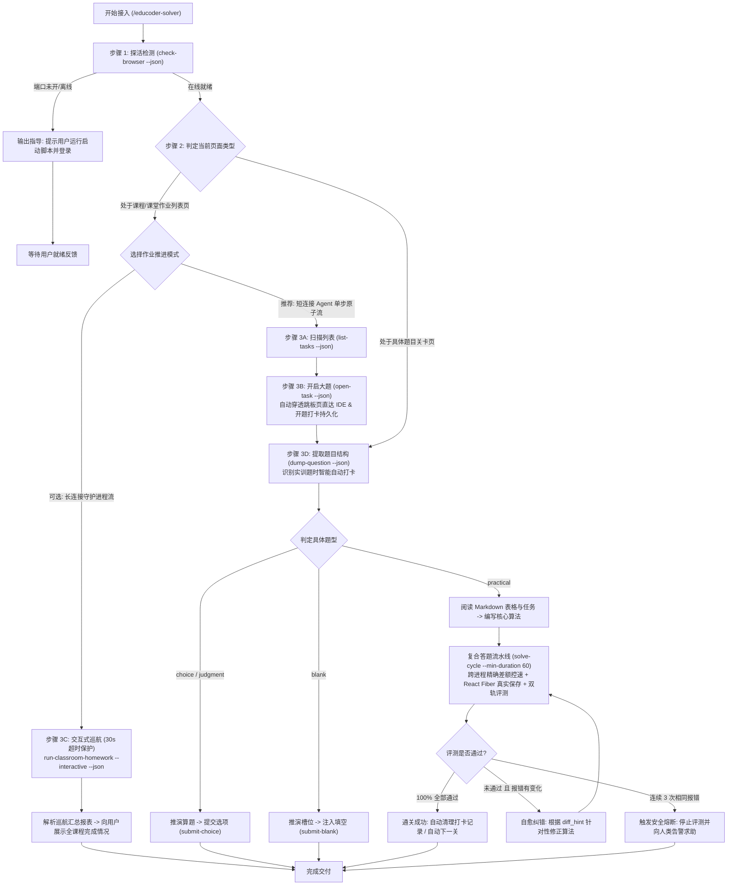

# 头歌自动答题系统 - 面向 AI 代理的操作手册 (AI Manual)

> **版本**：v4.1.0  
> **适用对象**：本地大型语言模型 / Agentic AI（如 Antigravity、Claude Code、Cursor 等本地执行代理）  
> **核心原则**：纯本地推理、零商业 API 依赖、真机 CDP 拟真交互、防秒刷跨进程持久化控速、React Fiber 真实保存、低熵提纯、大作业自动化巡航 (含跳板详情页自动穿透与多 Tab 自动生命周期回收)、标签页智能定向解耦 (prefer_type: classroom/shixun)、防封号防死循环

---

## 1. 代理核心定位与工作流

你（AI 代理）在此系统中担任**“认知推演大脑”**，系统提供的 Python CLI 工具（`src.cli`）充当你的**“感知眼与执行手”**。

### 1.1 智能双层决策树 (Decision Tree)

在面对头歌平台时，你首先探查当前页面处于**“课堂作业列表页”**还是**“单题关卡页”**，据此走不同的调度链路：



---

## 2. CLI 接口标准调用规范

所有 CLI 命令在由 AI 代理调用时，**必须且强制附带 `--json` 参数**。系统将把结构化数据输出到 `stdout`，人类可读日志输出到 `stderr`，确保你的 JSON 解析绝无污染。

运行环境：项目根目录下的 `.venv` 虚拟环境。  
Windows 推荐执行命令前缀：`.\.venv\Scripts\python -m src.cli`

---

### 2.1 浏览器与标签页探活 (`check-browser`)

用于在任何答题操作前探查本地 9222 端口及头歌页面。

```powershell
.\.venv\Scripts\python -m src.cli check-browser --json
```

#### JSON 输出契约
- **正常在线** (Exit Code 0)：
  ```json
  {
    "status": "online",
    "cdp_available": true,
    "host": "127.0.0.1",
    "port": 9222,
    "pages_count": 2,
    "has_educoder_page": true,
    "pages": [
      {
        "index": 0,
        "title": "课程作业列表 - 头歌教学平台",
        "url": "https://www.educoder.net/classrooms/xxxx/shixun_homeworks",
        "is_educoder": true
      }
    ]
  }
  ```
- **离线或端口未开** (Exit Code 1)：
  ```json
  {
    "status": "offline",
    "cdp_available": false,
    "host": "127.0.0.1",
    "port": 9222,
    "message": "CDP 远程调试端口 127.0.0.1:9222 未开启或未就绪"
  }
  ```

> **AI 动作指南**：
> 若 `cdp_available == false` 或 `has_educoder_page == false`，**切勿盲目重复调用**。立即向用户输出友好的引导提示，告知其运行 `.\scripts\launch_browser.ps1`，并在弹出的浏览器窗口中登录头歌。

---

### 2.2 课堂大作业推进工作流 (Classroom Homework Workflows)

当当前页面处于**课堂实训作业列表页**（URL 含 `classrooms`, `homeworks`, `shixuns`，且展示多道大题卡片）时，系统提供两种互补的工作流：

#### 2.2.1 推荐模式：AI Agent 单步原子流 (短连接一问一答首选)

针对短连接执行环境，将巡航拆解为非阻塞单步命令，每步独立返回，彻底规避长连接死锁：

1. **只读扫描作业列表 (`list-tasks`)**：
   ```powershell
   .\.venv\Scripts\python -m src.cli list-tasks --json
   # 若打开了多个标签页，可显式匹配：
   .\.venv\Scripts\python -m src.cli list-tasks --match homework --json
   ```
   **JSON 回执**：
   ```json
   {
     "status": "success",
     "total_tasks": 6,
     "completed_tasks": 2,
     "pending_tasks": 4,
     "tasks": [
       {"index": 0, "title": "实训大题 #1", "status": "已完成", "is_completed": true, "can_operate": false},
       {"index": 1, "title": "实训大题 #2", "status": "未完成", "is_completed": false, "can_operate": true}
     ]
   }
   ```

2. **单步开启指定大题 (`open-task`) [含跳板详情页自动穿透与开题打卡持久化]**：
   ```powershell
   # 默认开启第 1 个待完成大题
   .\.venv\Scripts\python -m src.cli open-task --json
   # 或指定大题索引：
   .\.venv\Scripts\python -m src.cli open-task --index 1 --json
   ```
   - **跳板详情页自动穿透 (`penetrate_detail_springboard`)**：头歌部分大题在点击后会进入 `/detail?tabs=` 介绍页，底层会自动探测并点击“继续挑战”/“开始实训”直达编程 IDE 关卡，并安全关闭中间跳板页，**无需 AI 进行二次开题识别**。
   - **开题打卡跨进程持久化 (`.cache/pacing_state.json`)**：捕获新关卡后，自动记录当前关卡开题时间戳至本地持久化缓存，供后续 `solve-cycle` 跨进程读取并精确扣减思考已耗时。
   - **首关预感知与遮罩扫除**：将其激活置顶并自动清理阻塞遮罩，返回首关概要及题型预览。

3. **进入关卡循环作答**：
   直接使用单题工具 `dump-question` -> `solve-cycle --auto-next` 流转；整道大题通关后，再次调用 `list-tasks` 扫描并推进下一题。

#### 2.2.2 守护模式：交互式巡航 (`run-classroom-homework`)

适用于具备长连接与实时双向 stdio 管道的外部守护进程：

```powershell
# 交互式巡航 (stdio JSON Lines 协议，内置 30s 超时看门狗防假死)
.\.venv\Scripts\python -m src.cli run-classroom-homework --interactive --min-duration 60 --json

# 演练模式 (仅扫描列出待做题目，不点击任何操作)
.\.venv\Scripts\python -m src.cli run-classroom-homework --dry-run --json
```

**交互握手协议格式**：
1. CLI 检测到题目后向 `stdout` 输出：
   `{"event": "question_detected", "task_title": "...", "level_index": 1, "question_type": "practical", "question_data": {...}}`
2. 外部控制器从 `stdin` 输入动作 JSON：
   `{"action": "solve", "code": "SELECT 1;", "target_only": true}` 或 `{"action": "skip"}`
3. CLI 完成评测并向 `stdout` 输出结果：
   `{"event": "eval_result", "passed": true, "diff_hint": "..."}`

> **AI 行为准则**：
> **严禁**在此类页面手写临时 Python 脚本去逐个查找元素或操作 Tab！请根据自身工具调用形态，选择 **单步原子流（模式 2.2.1）** 或 **交互式协程流（模式 2.2.2）**。


---

### 2.3 提取当前页面题目 (`dump-question`) [含 Table2Markdown 表格提纯]

自动探测当前关卡题型，提纯题干、HTML 表格（已自动转为标准 Markdown 表格）、附件图片说明、选项与靶心代码骨架。

```powershell
.\.venv\Scripts\python -m src.cli dump-question --json
```

#### JSON 输出契约 (核心字段)
```json
{
  "type": "choice | multiple_choice | judgment | blank | practical | unknown",
  "title": "第1关：创建数据表并设置主键约束",
  "description": "#### 编程要求\n请根据下表在 MySQL 中创建 `tb_student` 表：\n\n| 字段名 | 数据类型 | 约束条件 |\n| --- | --- | --- |\n| sno | char(10) | 主键 |\n| sname | varchar(20) | 非空 |\n\n[附图说明: 表结构关系图.png]",
  "options": [],
  "blanks": [],
  "practical_details": {
    "task_description": "创建指定数据表 tb_student 并添加主键约束",
    "sample_io": "预期结果包含 tb_student 表结构定义",
    "eval_instructions": "系统将执行 show tables 及 describe tb_student 进行断言",
    "code": "# 请在下方编写 SQL 语句\n########## Begin ##########\n\n########## End ##########\n",
    "prefix_code": "# 请在下方编写 SQL 语句\n########## Begin ##########\n",
    "target_code": "\n",
    "suffix_code": "########## End ##########\n",
    "language": "sql",
    "has_target_marker": true,
    "editor_type": "monaco",
    "is_blank_slate": false
  }
}
```

> **Table2Markdown 关键收益**：
> 题干中的数据表已被完整转换为 Markdown 表格（如 `| 字段名 | 数据类型 | 约束条件 |`），图片被替换为结构化标注 `[附图说明: xxx]`，**绝无 base64 乱码污染**，你只需专注于推演 SQL 或算法。

> **空白开卷题显式感知 (Blank Slate)**：
> 若 `practical_details.is_blank_slate == true`，表示该实训题未提供任何初始代码骨架（如全白纸算法开发），提示 AI Agent 必须从头全量编写完整代码（配合 `solve-cycle --full` 或全量注入），而不是仅填补局部靶心。

> **SPA 加载态防抖自愈 (SPA Loading Debounce)**：
> 关卡提取入口内置 `wait_for_spa_loading` 防抖自愈等待（默认 3.5s），自动检测“努力请求数据中”及 `.ldsRing`、`.ant-spin-spinning` 等异步遮罩，等待其消失且容器挂载完成，彻底杜绝关卡切换瞬间将页面误判为 `unknown`。

> **实训题智能开题打卡机制 (Smart Clock-in)**：
> 当识别到题目为代码实训题（`practical`）且当前关卡在 `.cache/pacing_state.json` 中尚未打卡时，CLI 会自动记录当前关卡开题时间戳。即便未走 `open-task` 而是用户/Agent 直接切入关卡进行感知，控速器也能精确捕捉到开题起点，杜绝后续 `solve-cycle` 误判为刚刚开题。

---

### 2.4 复合答题流水线 (`solve-cycle`) [实训题单题首选，集成跨进程控速与真实保存]

在单个 CDP 会话中一次性流转：**清理遮罩弹窗 -> Monaco/Fiber 内存穿透注入与 React 保存 -> 跨进程精确差额控速等待 -> CDP网络层拦截/DOM快照双轨评测 -> 高密度Diff提纯 -> (可选)流转下一关**。

```powershell
# 靶心模式注入并评测，默认 60s 拟真防刷控速 (推荐模式，自动读取开题打卡精确扣减)
.\.venv\Scripts\python -m src.cli solve-cycle --code "CREATE TABLE tb_student (sno CHAR(10) PRIMARY KEY, sname VARCHAR(20) NOT NULL);" --min-duration 60 --json

# 全量替换代码并在全绿后自动点击“下一关”
.\.venv\Scripts\python -m src.cli solve-cycle --file "solution.sql" --full --auto-next --min-duration 60 --json

# 通关后自动关闭当前关卡标签页 (v4.1 支持)
.\.venv\Scripts\python -m src.cli solve-cycle --code "SELECT 1;" --close-on-complete --json

# 快速自测模式 (min-duration 0 直出放行)
.\.venv\Scripts\python -m src.cli solve-cycle --code "SELECT * FROM tb_emp;" --min-duration 0 --json
```

#### JSON 输出契约 (高密度低熵，含 v4.1 保存与回收回执)
```json
{
  "success": true,
  "passed": true,
  "pass_ratio": "1/1",
  "expected": "sno char(10) PRI",
  "actual": "sno char(10) PRI",
  "diff_hint": "全部通过 (1/1)",
  "stdout_msg": "",
  "error_msg": "",
  "circuit_broken": false,
  "next_level_triggered": false,
  "page_closed": true,
  "overlays_dismissed": 1,
  "elapsed_seconds": 64.12,
  "injection": {
    "success": true,
    "method_used": "monaco_api",
    "backup_path": "E:/.../.cache/backups/backup_20261014.sql",
    "is_target_assembled": true,
    "saved": true,
    "commit_id": "commit_a1b2c3d4e5f6"
  },
  "message": "评测通过 (通过率: 1/1)"
}
```

> **v4.0 & v4.1 核心机制攻关点**：
> 1. **React SPA 深度 Fiber 穿透与双重保存保障**：
>    头歌现代前端为 React SPA。仅调用 Monaco 的 `setValue` 只修改了浏览器内存中的编辑器 Model，不会同步 React 组件 State，导致后台拉取到的仍是空代码或初始模板。v4.0 深度穿透 React Fiber (`__reactFiber$`, `__reactInternalInstance$`)，显式调用 `ed.onChange(val)` 通知 React 更新 State，随后调用 `ed.onSave(1)` 触发向后端提交 Git Commit 并获取 `commitID`；若组件未提供 `onSave`，自动模拟 `Control+S` 键盘快捷键并留出网络微延迟进行双重兜底，确保云端代码 100% 同步！
> 2. **智能防秒刷控速跨进程持久化**：
>    开题时间戳持久化存储于 `.cache/pacing_state.json`，`solve-cycle` 启动时读取并精确扣减已耗时（若 AI 推演与提取已用 40s，基准 60s 仅需等待 20s+ 抖动；若已超时则 0 秒极速放行），通关时自动清理当前关卡打卡记录。彻底消灭短连接模式下每题重复盲等 60s+（长达 75s+）的冗余等待。
> 3. **Monaco 全局大小写与容器类名兼容**：
>    支持 `window.monaco || window.Monaco`，并适配 `.monaco-editor, .my-monaco-editor` 等多种容器变体。
> 4. **标签页智能定向解耦与生命周期自动回收 (v4.1)**：
>    CLI 所有命令底层接入 `prefer_type` 智能路由器：`list-tasks` / `open-task` 默认锁定 `prefer_type="classroom"`（优先匹配作业列表页）；`dump-question` / `solve-cycle` 等解题命令默认锁定 `prefer_type="shixun"`（优先匹配关卡作答页），彻底根治多 Tab 并存时目标页抢占混淆。同时 `open_classroom_task` 在开启新题后自动调用 `cleanup_old_task_pages` 回收遗留的旧关卡 Tab，配合 `solve-cycle --close-on-complete` 实现标签页零残留与内存零泄露。

---

### 2.5 提交客观选择题/判断题 (`submit-choice`)

```powershell
# 单选或判断
.\.venv\Scripts\python -m src.cli submit-choice --options A --json
.\.venv\Scripts\python -m src.cli submit-choice --options 正确 --json

# 多选 (逗号分隔)
.\.venv\Scripts\python -m src.cli submit-choice --options A,C,D --json
```

*(内置防反选保护机制，已勾选的选项自动跳过，绝不会发生误取消)*

---

### 2.6 提交文本填空题 (`submit-blank`)

```powershell
.\.venv\Scripts\python -m src.cli submit-blank --answers '["答案一", "答案二"]' --json
```

*(自动派发 `input`、`change`、`blur` 原生事件，确保数据双向绑定并持久化)*

---

### 2.7 分步注入编程实训题代码 (`inject-code`)

```powershell
# 靶心注入
.\.venv\Scripts\python -m src.cli inject-code --code "    return sum(nums) / len(nums)" --json

# 全量注入
.\.venv\Scripts\python -m src.cli inject-code --file ./solution.py --full --json
```

*(内置快照自动备份至 `.cache/backups/`，且优先穿透 Monaco/Ace 及 React/Vue Fiber 原生 API)*

---

### 2.8 分步触发评测与状态监听 (`trigger-eval`)

```powershell
# 触发评测并等待回执 (双轨拦截优先)
.\.venv\Scripts\python -m src.cli trigger-eval --timeout 60 --json

# 评测通过后自动流转下一关
.\.venv\Scripts\python -m src.cli trigger-eval --auto-next --json
```

---

## 3. 核心行为红线与自愈风控体系 (Agent Guardrails)

在自动化接管全过程中，你必须严格恪守以下铁律：

### 3.1 防秒刷控速与跨进程打卡持久化规范 (Anti-Cheat Pacing & Persistence Protocol)
- **高校教师端审查原理**：高校实训平台的教师端管理后台会清晰记录每个学生的每题用时与提交日志。如果一道 50 行的编程题在关卡开启后 3 秒内即提交满分，会被教师后台直接标记为“作弊/代刷”！
- **跨进程打卡持久化机制 (`.cache/pacing_state.json`)**：在短连接 CLI 模式下，每个 CLI 子命令（如 `open-task`、`dump-question`、`solve-cycle`）由独立的 Python 进程承载。v4.0 引入了本地原子持久化缓存，通过 URL 规范化路径统一键值索引，自动记录并持久化开题时间戳：
  1. `open-task` 成功开启大题并进入关卡时自动打卡；
  2. `dump-question` 提取到代码实训题且尚未打卡时自动补全打卡；
  3. `solve-cycle` 启动时直接从持久化文件读取开题时间戳，精准计算已消耗时长；
  4. 关卡通关（`passed: true`）后自动清理该关卡的打卡缓存记录；
  5. 自动失效保护：超过 2 小时的陈旧缓存自动过滤清除；文件通过原子临时文件替换（`replace`）写入，防止并发写坏。
- **智能差额算法**：系统默认采用 `--min-duration 60`（基准 60 秒 + 5~20 秒离散拟真抖动）。从持久化开题时间戳起算，如果 AI 提取与推演已耗时 40 秒，则仅需等待约 20 秒差额；若已超过目标时长，则 0 秒极速放行。等待期间每 15 秒向页面注入微滚动活跃度心跳（`window.scrollBy`），保证页面处于真实活跃状态。
- **快速自测例外**：仅在本地冒烟验证、编写单元测试或用户显式要求“极速不控速”时，方可指定 `--min-duration 0`。

### 3.2 课堂大作业编排优先准则
- 当在作业列表页时，**坚决优先使用官方命令链推进**：一问一答短连接 Agent 选用单步原子流（`list-tasks` -> `open-task` -> `solve-cycle`）；具备持续双向 stdio 通道时使用 `run-classroom-homework --interactive`。
- 严禁手写零散的 Playwright 临时脚本关闭 Tab 或切换窗口。底层的编排器已封装完备的异常重试、页面恢复与列表刷新逻辑。

### 3.3 题干表格 Markdown 结构化与低熵多模态原则
- 题干中所有 `<table>` 均已被底层提取器转为紧凑 Markdown 表格，图片已被替换为文本引用标签。
- 严禁输出原始 HTML 或 base64 图片乱码，确保上下文只包含最精炼的高信息密度内容。

### 3.4 评测双轨监听与 `\d+S` 倒计时过滤
- 系统采用**网络层优先拦截（CDP `expect_response` 监听后端评测接口）+ DOM 快照比对兜底**的双轨机制。
- 在 DOM 比对兜底中，必须识别评测按钮上的倒计时文本（如 `\d+S`、`评测中`），并在快照中验证 `_has_real_result`（过滤初始的“平台会对你编写的代码进行测试”占位符），严禁在倒计时未结束前提前误判通关。

### 3.5 评测自愈循环与熔断协议 (Circuit Breaker)
当实训题评测返回 `passed == false` 时：
1. **分析差异**：根据低熵回执中的 `diff_hint`、`expected` 与 `actual` 进行针对性修正；
2. **修正代码**：优先再次调用 `solve-cycle` 更新靶心代码；
3. **熔断阈值（强制红线）**：
   - 如果连续 **3 次** 评测返回的报错内容完全一致（`circuit_broken == true`），**严禁继续盲目重复提交**！
   - 此时必须停止尝试，向用户汇报当前卡点、报错信息与推测原因，请求人类协同介入。

### 3.6 React SPA 编辑器真实状态变更与 Git 提交保存红线 (State & Save Protocol)
- **严禁仅修改 Monaco Model 内存即触发评测**：头歌平台前端为 React SPA，评测时沙箱容器会直接拉取后端云端 Git 仓库的代码。如果仅在 Monaco Editor 中调用 `setValue`，React 组件 State 未被更新，平台无法派发保存请求，云端代码依然为空或历史模板。
- **双重保存闭环**：代码注入必须穿透 React Fiber 调用组件的 `ed.onChange(val)` 与 `ed.onSave(1)` 并提取 `commitID`；若组件未挂载 `onSave`，必须自动通过 `Control+S` 键盘快捷键并留出网络延迟兜底保存，确保回执中 `saved == true` 方可触发评测。

---

## 4. 故障排查速查表 (Troubleshooting)

| 现象 | 可能原因 | AI 对策 |
| :--- | :--- | :--- |
| `check-browser` 提示 `cdp_available: false` | 物理浏览器未开启 9222 调试端口 | 提示用户在终端运行 `.\scripts\launch_browser.ps1` |
| 执行巡航命令时进程挂住/死锁 | 交互模式 (`--interactive`) 卡在等待 stdin，但 Agent 属于一问一答短连接调用 | 系统已内置 30s 超时看门狗自动释放退出；**强烈推荐换用单步原子流（`list-tasks` -> `open-task` -> `solve-cycle`）**，彻底避免长连接死锁 |
| `list-tasks` 扫描到 0 道大题 / 空跑 | 浏览器停留在 `/classrooms` 班级总览页而非作业列表页，或打开了多个干扰标签页 | 使用 `--match` 参数精确指定作业页面关键词，如 `list-tasks --match homework --json`，或请用户点进具体作业列表 |
| `open-task` 停留在 `/detail?tabs=` 详情页无法直接做题 | 部分大题包含前置实训介绍跳板页，未直接进入 IDE 编程关卡 | v4.0 内置 `penetrate_detail_springboard` 自动穿透机制，检测到跳板页自动点击“开始实训/继续挑战”直达 IDE，并安全关闭中间页，无需 Agent 二次开题 |
| 短连接 CLI 模式下每道题重复盲等 60s+ 甚至 75s+ | 短连接模式下进程退出导致开题打卡内存丢失，误以为刚刚开题 | v4.0 引入 `.cache/pacing_state.json` 跨进程打卡持久化，`open-task` 与 `dump-question` 自动打卡，`solve-cycle` 精确计算并扣减思考已耗时，超时则 0 秒直出 |
| 评测结果显示实际输出为空 / 初始模板代码未生效 | 头歌 React SPA 状态未同步，未向平台 Git 提交代码 | v4.0 已实现 React Fiber 深度穿透：注入时显式调用 `ed.onChange` 与 `ed.onSave` 并提取 `commit_id`，配合 `Ctrl+S` 双重兜底，确保代码真正持久化至后端 Git 仓库后再评测 |
| 编辑器无法识别或提示 `window.Monaco` 报错 | 部分关卡打包配置使用首字母大写 `window.Monaco` 或类名 `.my-monaco-editor` | v4.0 已全面兼容 `window.monaco || window.Monaco` 及容器类名 `.monaco-editor, .my-monaco-editor`，支持跨 Frames 与 Fiber 穿透识别 |
| 实训题提示靶心代码为空/拒绝评测 | 靶心代码区域未识别或解题代码为空 | 底层已加入空模板防护，不再拿空白代码盲评；请先 `dump-question` 查看任务要求，再使用 `solve-cycle --code "<代码>"` 正式作答 |
| `dump-question` 返回 `type: unknown` | 处于课程目录页或页面加载尚未完成 | 若在作业列表页，改用 `list-tasks`；若在关卡页，等待 2 秒后重试 |
| 在作业列表页不知如何推进且不敢写脚本 | 陷入“禁止写临时脚本”与“缺少单步命令”的困境 | 官方原生提供单步推进命令：`list-tasks` 扫列表 -> `open-task` 开大题 -> 关卡内 `solve-cycle` 闭环做题，无需写任何临时脚本 |
| `submit-choice` 未能成功勾选 | 选项标识匹配异常（题干使用特殊序号或带括号） | 从 `dump-question` 返回的 `options` 中提取确切的 `id` 或文本重新尝试 |
| `solve-cycle` 报错提示超时 | 头歌后台排队评测中或代码中含有死循环 | 检查代码是否存在死循环；超时后先 `dump-question` 观察状态 |
| 评测出现指针拦截错误 (`intercepts pointer events`) | 平台弹出通关庆祝模态框未完全关闭 | 底层 `ModalSweeper` 会自动扫除；若仍出现，提示用户手动在物理浏览器上点击关闭 |
| 答题过程中标签页堆积 / 关卡页抢占作业列表扫描 | 多大题流转时旧关卡 Tab 未及时释放导致定位混淆与内存膨胀 | v4.1 已原生集成智能解耦与自动回收：列表命令锁定 `prefer_type="classroom"`，做题命令锁定 `prefer_type="shixun"`；`open-task` 自动回收旧关卡 Tab，`solve-cycle` 支持 `--close-on-complete` 通关即关 |

