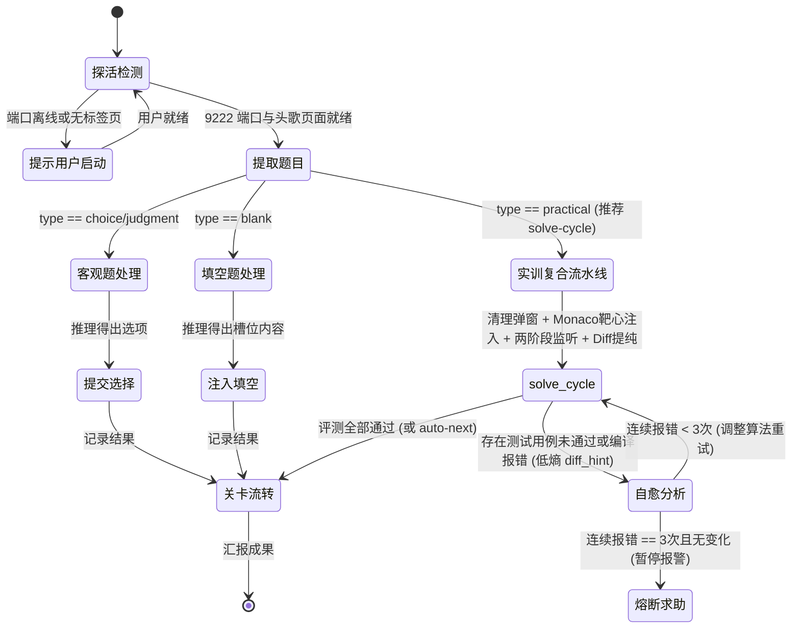

# 头歌自动答题系统 - 面向 AI 代理的操作手册 (AI Manual)

> **版本**：v2.0.0  
> **适用对象**：本地大型语言模型 / Agentic AI（如 Antigravity、Claude Code、Cursor 等本地执行代理）  
> **核心原则**：纯本地推理、零商业 API 依赖、真机 CDP 拟真交互、低熵提纯、防封号防死循环

---

## 1. 代理核心定位与工作流

你（AI 代理）在此系统中担任**“认知推演大脑”**，系统提供的 Python CLI 工具（`src.cli`）充当你的**“感知眼与执行手”**。

### 1.1 标准答题闭环状态机



---

## 2. CLI 接口标准调用规范

所有 CLI 命令在由 AI 代理调用时，**必须且强制附带 `--json` 参数**。系统将把结构化数据输出到 `stdout`，人类可读日志输出到 `stderr`，确保你的 JSON 解析绝无污染。

运行环境：项目根目录下的 `.venv` 虚拟环境。  
Windows 推荐执行命令前缀：`.\.venv\Scripts\python -m src.cli`

---

### 2.1 浏览器与标签页探活 (`check-browser`)

用于在任何答题操作前探查本地 9222 端口及头歌页面。

```powershell
.\.venv\Scripts\python -m src.cli check-browser --json
```

#### JSON 输出契约
- **正常在线** (Exit Code 0)：
  ```json
  {
    "status": "online",
    "cdp_available": true,
    "host": "127.0.0.1",
    "port": 9222,
    "pages_count": 2,
    "has_educoder_page": true,
    "pages": [
      {
        "index": 0,
        "title": "实训项目 - 头歌教学平台",
        "url": "https://www.educoder.net/tasks/xxxx",
        "is_educoder": true
      }
    ]
  }
  ```
- **离线或端口未开** (Exit Code 1)：
  ```json
  {
    "status": "offline",
    "cdp_available": false,
    "host": "127.0.0.1",
    "port": 9222,
    "message": "CDP 远程调试端口 127.0.0.1:9222 未开启或未就绪"
  }
  ```

> **AI 动作指南**：
> 若 `cdp_available == false` 或 `has_educoder_page == false`，**切勿盲目重复调用**。立即向用户输出友好的引导提示，告知其运行 `.\scripts\launch_browser.ps1`，在弹出的窗口中登录头歌并进入题目关卡。

---

### 2.2 提取当前页面题目 (`dump-question`)

自动探测当前关卡题型，提纯题干、选项、代码模板与核心区域。

```powershell
.\.venv\Scripts\python -m src.cli dump-question --json
```

#### JSON 输出契约 (核心字段)
```json
{
  "type": "choice | multiple_choice | judgment | blank | practical | unknown",
  "title": "题目主标题",
  "description": "题目详细说明/背景（Markdown格式）",
  "options": [
    {
      "id": "A",
      "text": "选项文本",
      "selected": false,
      "locator_index": 0
    }
  ],
  "blanks": [
    {
      "index": 0,
      "hint": "提示信息/placeholder",
      "prefix_text": "空位前置上下文",
      "suffix_text": "空位后置上下文",
      "current_value": ""
    }
  ],
  "practical_details": {
    "task_description": "实训关卡通关要求",
    "sample_io": "输入输出样例",
    "eval_instructions": "评测规则",
    "code": "当前编辑器完整代码",
    "prefix_code": "含 Begin 标记的不可变前置代码",
    "target_code": "Begin-End 之间的核心待编写算法代码",
    "suffix_code": "含 End 标记的不可变后置代码",
    "language": "python | cpp | java | sql | ...",
    "has_target_marker": true,
    "editor_type": "monaco | ace | dom"
  }
}
```

---

### 2.3 复合答题流水线 (`solve-cycle`) [强烈推荐，实训题首选]

在单个 CDP 会话中一次性流转：**清理遮罩弹窗 -> Monaco无损注入 -> 两阶段防竞态评测 -> 高密度Diff提纯 -> (可选)流转下一关**。
将单次调试循环耗时从 30s 缩减至 5~8s，大幅消除进程冷启动开销。

```powershell
# 靶心模式注入并评测 (仅传入 Begin-End 内部算法)
.\.venv\Scripts\python -m src.cli solve-cycle --code "    return sum(nums) / len(nums)" --json

# 全量替换模式并评测通过后自动流转下一关
.\.venv\Scripts\python -m src.cli solve-cycle --file "solution.py" --full --auto-next --json
```

#### JSON 输出契约 (高密度低熵)
```json
{
  "success": true,
  "passed": false,
  "pass_ratio": "0/1",
  "expected": "8",
  "actual": "7",
  "diff_hint": "第 1 行内容不匹配: 预期 '8' vs 实际 '7'",
  "stdout_msg": "",
  "error_msg": "AssertionError: 8 != 7",
  "circuit_broken": false,
  "next_level_triggered": false,
  "overlays_dismissed": 1,
  "elapsed_seconds": 6.32,
  "injection": {
    "success": true,
    "method_used": "monaco_api",
    "backup_path": ".../backup_20261003.py",
    "is_target_assembled": true
  },
  "message": "评测未通过 (通过率: 0/1)"
}
```

---

### 2.4 提交客观选择题/判断题 (`submit-choice`)

```powershell
# 单选或判断
.\.venv\Scripts\python -m src.cli submit-choice --options A --json
.\.venv\Scripts\python -m src.cli submit-choice --options 正确 --json

# 多选 (逗号分隔)
.\.venv\Scripts\python -m src.cli submit-choice --options A,C,D --json
```

#### 防误点反选机制 (Anti-Uncheck)
执行器内部已内置状态防反选安全校验：
- 若选项 A 当前已在页面中处于勾选状态，执行器**自动跳过点击**，防止重复点击导致取消选择。
- AI 无需担心多选题幂等性问题。

---

### 2.5 提交文本填空题 (`submit-blank`)

```powershell
.\.venv\Scripts\python -m src.cli submit-blank --answers '["答案一", "答案二"]' --json
```

执行器会自动为每个输入槽位执行 `focus` -> `fill`，并派发原生 `input`、`change`、`blur` 事件，确保 Vue / React 双向数据绑定生效并触发自动保存。

---

### 2.6 分步注入编程实训题代码 (`inject-code`)

```powershell
# 仅替换 Begin-End 核心算法区 (默认模式)
.\.venv\Scripts\python -m src.cli inject-code --code "    return sum(nums) / len(nums)" --json

# 全量替换整个编辑器内容
.\.venv\Scripts\python -m src.cli inject-code --code "完整代码..." --full --json

# 从本地文件读取注入
.\.venv\Scripts\python -m src.cli inject-code --file ./solution.py --json
```

#### 安全与注入规范
1. **自动备份保障**：代码覆写前，执行器已自动将原代码持久化保存在 `.cache/backups/backup_<timestamp>.<ext>`，用户历史代码绝不丢失。
2. **Monaco API 优先**：内部自动通过 `monaco.editor.getModels()[0].setValue()` 注入，杜绝直接修改 innerHTML 破坏编辑器挂载。
3. **缩进注意**：传递 `--code` 时，请保持核心算法相对于 `Begin-End` 外围骨架的标准缩进（如 4 空格）。

---

### 2.7 分步触发评测与状态监听 (`trigger-eval`)

```powershell
# 触发评测并等待评测结束 (默认超时 60 秒)
.\.venv\Scripts\python -m src.cli trigger-eval --timeout 60 --json

# 评测通过后自动点击“下一关”
.\.venv\Scripts\python -m src.cli trigger-eval --auto-next --json
```

---

## 3. 核心行为红线与自愈风控体系 (Agent Guardrails)

在自动答题过程中，你必须严格遵守以下准则：

### 3.1 评测自愈循环与熔断协议 (Circuit Breaker)
当实训题评测返回 `passed == false` 时：
1. **分析差异**：根据低熵回执中的 `diff_hint`、`expected` 与 `actual` 进行针对性修正。
2. **修正代码**：优先再次调用 `solve-cycle`（或 `inject-code`）更新靶心代码。
3. **熔断阈值（强制红线）**：
   - 如果连续 **3 次** 评测返回的报错内容完全一致（`circuit_broken == true`），**严禁继续调用评测**！
   - 此时必须停止尝试，向用户汇报当前卡点、报错信息与推测原因，请求人类协同介入。

### 3.2 低熵输出与信息提纯原则 (Low-Entropy Protocol)
- **绝对禁止吐出未清洗 DOM**：大模型上下文中严禁充斥无意义的 HTML 标签、内联 CSS、页面杂质或庞大 DOM 树。
- **信息高密度**：所有的评测回执必须收敛为结构化的 `diff_hint` 与测试用例比对，让 AI 能够一眼看清算法的逻辑缺陷（如多了一行、首尾空格、字段别名大小写等），把心智带宽集中在解题上。

### 3.3 弹窗自动扫除与两阶段防竞态机制
- **弹窗前置清除**：在下发任何交互前，底层均已挂载 `ModalSweeper` 自动关闭通关提示与清理遮罩，AI 无需再耗费注意力去调试“元素被遮挡”等前端偶发异常。
- **两阶段防竞态监听**：通过点击后的 500~800ms 观察期与 DOM 结果快照比对，确保每一次获得的评测反馈都是本次代码运行的全新回执，彻底根治过早读取上一关历史结果的竞态 BUG。

### 3.4 拟真交互防刷策略
- 所有的 CLI 动作内部均已封装拟真随机间隔。
- AI 在连续答题（如刷多道客观题）时，应在各题之间向用户输出一两句简明的题意解释与作答总结，保持自然节奏，避免瞬间连发 CLI 触发平台访问频率封控。

---

## 4. 故障排查速查表 (Troubleshooting)

| 现象 | 可能原因 | AI 对策 |
| :--- | :--- | :--- |
| `check-browser` 提示 `cdp_available: false` | 物理浏览器未开启 9222 端口 | 指导用户执行 `.\scripts\launch_browser.ps1` |
| `dump-question` 返回 `type: unknown` | 页面尚在加载或处于课程目录列表页 | 提示用户进入具体的作业/实验关卡页面 |
| `submit-choice` 未能成功勾选 | 选项标识匹配异常（如题干使用小写或特殊符号） | 从 `dump-question` 返回的 `options` 中提取确切的 `id` 或文本重新尝试 |
| `solve-cycle` 报错提示超时 | 头歌后台排队评测中或代码中含有死循环 | 检查算法是否存在 `while True` 等死循环；超时后先 `dump-question` 观察状态 |
| 评测出现指针拦截错误 (`intercepts pointer events`) | 平台弹出了特殊模态框未被关闭 | 底层已内置自动清理；若依然出现，提示用户手动在物理浏览器上点击关闭 |
