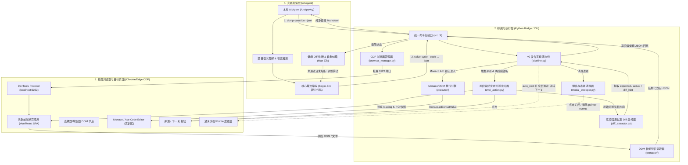

# 头歌（Educoder）全自动交互答题系统 - 架构设计与实现规划 (project.md)

---

## 1. 项目概述与愿景

### 1.1 背景与目标
本项目旨在打造一套由本地 AI Agent（如 Antigravity / 本机大模型）闭环接管、操控物理浏览器的头歌（Educoder）平台全自动答题系统。
系统旨在减轻高校学生/学员在日常实训、随堂测验与编程作业中的机械式复制粘贴负担，实现：
1. **真实物理接管**：免密无感登录，借由 Chrome/Edge 远程调试端口直接挂载用户已登录的浏览器会话，规避验证码与账号密码明文存储风险。
2. **零第三方商用 API 依赖**：AI 认知推演完全由本地已接入的模型担当，不产生外部 Token 账单与中转风险。
3. **分层拟真交互**：通过自动化工具充当“手眼”，AI Agent 充当“大脑”，以真实用户点击与键盘动作与前端 DOM / Monaco Editor 进行交互，降低平台封号风控。
4. **低熵提纯与极致效率**：严禁向大模型塞入未经清洗的 DOM 杂音与报错堆栈，将单关调试交互耗时压缩至 5~8 秒，全面保护 AI 心智带宽。

---

## 2. 系统整体架构设计 (System Architecture)

系统遵循 **“大脑-手眼解耦” (Brain-Hands Decoupling)** 与 **“低熵高能效流水线” (Low-Entropy Pipeline)** 原则，整体划分为三层体系：



### 2.1 各层职责划分
1. **决策层 (Brain)**：由本地 AI Agent 驱动。只负责“读懂题目上下文”并“编写算法逻辑”。得益于底层低熵提纯器，AI 彻底免除 DOM 杂音与选择器异常的干扰，聚焦于解题。
2. **桥梁层 (Bridge)**：基于 Python 3.12 + Playwright。在 v2 中全面演进为复合流水线架构：
   - `run_solve_cycle()`：在单一 CDP 会话中无缝流转清理、注入、评测、提纯与下一关；
   - `modal_sweeper`：清理通关庆祝弹窗与透明遮罩；
   - `eval_action` 两阶段监听：彻底解决前端 AJAX 延迟竞态与读取上一关历史结果的缺陷；
   - `diff_extractor`：清洗 ANSI 转义码与 HTML 杂质，提纯预期值与实际值的高信息密度对比。
3. **物理层 (Browser)**：用户前台打开的真实 Chrome 或 Edge 浏览器（开启 `--remote-debugging-port=9222`），头歌页面在此正常加载并保持登录态。

---

## 3. 技术栈与模块目录设计

### 3.1 核心技术选型
- **开发语言**：Python 3.12+ (独立虚拟环境 `.venv`)
- **自动化底座**：Playwright for Python (`playwright.sync_api` / `connect_over_cdp`)
  - *选型理由*：原生支持 CDP 协议无缝挂载已有浏览器标签页，API 现代，选择器机制强大，支持复杂的 iframe 穿透与 Monaco 编辑器上下文执行。
- **HTML/DOM 提纯**：BeautifulSoup4 + Markdownify
  - *选型理由*：清洗富文本与复杂内嵌样式，将题干与代码骨架提纯为纯净 Markdown 供 Agent 理解。
- **CLI 框架**：Argparse + Rich
  - *选型理由*：无外部复杂依赖，兼顾人类终端排错的易读彩色渲染与 AI Agent 的结构化 `--json` 纯净输出。

### 3.2 实际项目落地目录结构
```text
tou ge/
├── AGENTS.md                  # AI Agent 开发规范与行为红线 (v2 增加低熵与流水线要求)
├── agent.md                   # 规范文件镜像/同步
├── project.md                 # 架构设计、实现路径与运维总纲 (本文档)
├── 头歌自动答题系统_需求与方向规划.md # 原始 PRD 需求文档
├── 优化建议.txt               # 实战痛点复盘与 v2 架构演进提案
├── requirements.txt           # 核心依赖清单 (playwright, beautifulsoup4, rich, pytest)
├── .gitignore                 # 忽略 .venv, .cache, __pycache__ 等
├── docs/
│   └── AI_MANUAL.md           # 面向 AI 代理的详尽操作手册与 CLI 契约
├── scripts/                   # 便捷运维脚本
│   ├── launch_browser.ps1     # 快速启动带 CDP 调试端口的 Chrome/Edge (PowerShell)
│   └── launch_browser.bat     # Windows 批处理版本 (双击即用)
├── src/
│   ├── __init__.py            # 版本与包说明 (v2.0.0)
│   ├── config.py              # 全局配置 (CDP端口 9222、超时时间、拟真延迟范围)
│   ├── cli.py                 # 统一命令行调度入口 (8 大标准子命令，含 solve-cycle)
│   ├── browser/
│   │   ├── __init__.py
│   │   └── manager.py         # CDP 端口探活、Tab 路由、防误关保护上下文
│   ├── extractor/
│   │   ├── __init__.py
│   │   ├── base.py            # 数据模型 (QuestionData, ChoiceOption, BlankItem 等)
│   │   ├── choice.py          # 单选、多选、判断题 DOM 解析与状态识别
│   │   ├── blank.py           # 填空题槽位提取与选择器绑定
│   │   ├── practical.py       # 实训题 (任务、样例、Monaco代码读取、Begin-End靶心拆分)
│   │   └── detector.py        # 题型智能自适应探测器
│   ├── executor/
│   │   ├── __init__.py
│   │   ├── choice_action.py   # 选择题防反选拟真点击
│   │   ├── blank_action.py    # 填空项精准键入与 Vue/React 事件分发
│   │   ├── editor_action.py   # Monaco API 代码注入与快照自动备份
│   │   ├── eval_action.py     # 两阶段防竞态评测监听、连续报错熔断 (3次限制)、下一关
│   │   ├── modal_sweeper.py   # [v2] 弹窗与指针拦截遮罩自动清理器
│   │   ├── diff_extractor.py  # [v2] 高密度测试集预期与实际输出 Diff 提纯器
│   │   └── pipeline.py        # [v2] 复合答题流水线 (Solve Cycle Engine)
│   └── utils/
│       ├── __init__.py
│       ├── delay.py           # 拟真随机微延迟 (同步与异步)
│       └── logger.py          # Rich 终端美化与纯净 JSON 格式化输出
└── tests/                     # 自动化质量保证测试集 (88 个测试用例，100% 通过)
    ├── fixtures/
    │   └── html_samples.py    # 高仿真单选/多选/判断/填空/实训页面 DOM 样本
    ├── test_browser.py        # 浏览器管理器与探活测试 (7 tests)
    ├── test_cli.py            # CLI 参数解析与 JSON 输出契约测试 (13 tests)
    ├── test_config.py         # 全局配置与环境变量覆盖测试 (2 tests)
    ├── test_delay.py          # 拟真随机延迟执行测试 (4 tests)
    ├── test_diff_extractor.py # [v2] 测试集 Diff 提取与 ANSI/HTML 过滤测试 (12 tests)
    ├── test_executor.py       # 动作执行、备份、Monaco注入与熔断器测试 (17 tests)
    ├── test_extractor.py      # 全题型提取与 Begin-End 区域切分测试 (22 tests)
    ├── test_logger.py         # 日志与 JSON 静默模式测试 (3 tests)
    └── test_pipeline.py       # [v2] 复合流水线闭环与异常处理测试 (8 tests)
```

---

## 4. 核心功能实现路径与技术攻关点

### 4.1 核心题型攻关逻辑

#### 1. 客观选择题与判断题
- **状态感知**：精准定位选项容器（`.subject-item`, `.option-item`, `.ant-radio-wrapper`, `.ant-checkbox-wrapper`）。提取选项标识（A/B/C/D）及其文本描述。
- **多选题防反选机制 (Anti-Uncheck)**：在执行多选点击前，先校验当前项是否已被勾选（`is_checked()` 或 class 含 `checked`），仅点击未勾选的目标选项，严禁将已选中的误点取消。
- **拟真交互**：两次点击之间插入 `random_delay(0.3, 0.8)` 秒拟真间隔。

#### 2. 文本填空题
- **槽位识别**：识别题干中的下划线槽位或 `input.answer-input`。
- **双向绑定保障**：先做 `element.click()` 聚焦，再 `element.fill(text)`，最后通过 `page.evaluate()` 触发原生 `input`、`change`、`blur` 事件，确保 Vue/React 数据双向绑定更新。

#### 3. 编程实训题基础机制
- **代码模板与 Begin-End 提取**：
  - 通过正则识别靶心区：`r"(?://|#|--|/\*|<!--)\s*##########\s*Begin\s*##########\s*[\r\n]+([\s\S]*?)(?://|#|--|/\*|<!--)\s*##########\s*End\s*##########"`。
  - 智能拆分为 `prefix_code`、`target_code`、`suffix_code`，保证 `prefix_code + target_code + suffix_code == code` 零损组装。
- **快照自动备份**：在覆盖写入前，系统自动将当前代码写入 `.cache/backups/backup_<timestamp>.<ext>`，确保用户历史代码绝不丢失。
- **Monaco Editor 分级注入路线**：
  1. *首选方案 (API Direct)*：`page.evaluate("val => window.monaco.editor.getModels()[0].setValue(val)", code)`
  2. *次选方案*：Ace Editor API `ace.edit().setValue(code)`
  3. *兜底方案*：点击聚焦 -> `Control+A` -> `Backspace` -> 键入注入。

---

### 4.2 v2 核心引擎四大攻坚突破

在 v1 实机联调中，我们发现三类严重影响效率与 AI 解题准确率的问题：频繁冷启动导致单循环耗时 30s+、AJAX 竞态导致过早读到上一关旧结果、大段 DOM 杂质严重污染大模型注意力。为此，v2 实施了四大重构攻坚：

#### 突破 1：复合答题流水线 (`run_solve_cycle`)
- **痛点**：以往一次实训题答题需要 Agent 分别调用 3~4 次 CLI（`dump` -> `inject` -> `eval` -> `next`）。每个 CLI 命令均为独立 Python 进程，必须经历解释器加载、Playwright 初始化以及 TCP 握手和 CDP 协商，单次额外开销多达 2~4 秒，全套循环耗时超过 30 秒。
- **方案**：`src/executor/pipeline.py` 实现 `run_solve_cycle`，在单个 CDP Page 会话内一次性执行【清理遮罩 -> Monaco代码注入 -> 两阶段评测监听 -> Diff提纯 -> 自动流转下一关】。
- **收益**：单关调试交互耗时从 30s 缩减至 **5~8 秒**，Agent 交互轮次由 3 轮合并为 1 轮。

#### 突破 2：弹窗与遮罩清理器 (`ModalSweeper`)
- **痛点**：头歌平台通关后会弹出全屏的金币/经验通关弹窗（如 `.evaluate-result-container`），或者残留有不透明的 Vue/AntD 模态框，导致后续 Playwright 点击操作抛出 `intercepts pointer events` 异常，甚至迫使 AI 陷入无谓的选择器调试。
- **方案**：`src/executor/modal_sweeper.py` 采用双轨清理：
  1. 自动化点击常见弹窗的关闭按钮（`.ant-modal-close`, `button:has-text('继续挑战')`, `button:has-text('我知道了')` 等）；
  2. 执行轻量 JS 脚本遍历检测页面上的遮罩（`.ant-modal-mask`, `.modal-backdrop` 等），对于无可见内容或透明度极低的残留死锁遮罩，主动设为 `pointerEvents = 'none'; display = 'none'`。
- **收益**：彻底消除指针拦截异常，保障全流程无人值守顺畅运行。

#### 突破 3：两阶段防竞态评测监听器 (Two-Phase Race-Free Evaluator)
- **痛点**：点击“评测”按钮后，平台后端的判题脚本需要数秒执行时间，而前端的 loading 状态并非毫秒级渲染。工具若在发出点击后立即检查状态，极易在第 1 秒就误以为“评测已结束”，继而读取到上一关或上一次运行的历史旧输出，导致 AI 获得错误反馈甚至误判通关。
- **方案**：`src/executor/eval_action.py` 引入两阶段状态机防竞态模型：
  - **阶段一 (等待启动态)**：点击后维持 500ms~800ms 的观察期，强制侦听直到页面出现 loading 状态或评测请求发出（若极速通关弹窗出现则可提前返回）；
  - **阶段二 (等待完成与快照比对态)**：在 loading 消失后，通过 `get_result_snapshot()` 将当前评测区域内容与触发前的快照比对，必须检测到内容更新或弹窗弹出方确认为本次评测完成。
- **收益**：彻底根除异步竞态假阳性，确保评测回执 100% 真实可靠。

#### 突破 4：高信息密度测试集 Diff 提纯器 (`TestcaseDiffExtractor`)
- **痛点**：头歌的评测输出面板混合了大量 HTML 标签、不可见的空白字符（`\u00a0`, `\u200b`）、终端 ANSI 颜色转义码，甚至抓取到页面内部的全局脚本代码。大段杂音直接塞满上下文窗口，割裂了 AI 思考题目的心智带宽（Attention Drift）。
- **方案**：`src/executor/diff_extractor.py` 构建专项清洗与差异比对模型：
  - 正则清洗所有 ANSI 终端转义序列；
  - 反转义 HTML 实体并规整不可见字符；
  - 智能拆解预期输出（`expected`）与实际输出（`actual`），并自动计算精炼的 `diff_hint`（例如“第 1 行内容不匹配: 预期 '8' vs 实际 '7'”或“行数不匹配，预期3行，实际0行”）。
- **收益**：输出 JSON 保持极致低熵，AI 一目了然看到逻辑偏差，解题成功率大幅提升。

---

## 5. 项目分阶段实施路线图 (Roadmap & Status)

| 阶段 | 核心目标与交付物 | 状态 | 关键成果 |
| :--- | :--- | :---: | :--- |
| **Phase 1** | **环境脚手架与客观题全链路贯通**<br>- 启动脚本 `launch_browser.ps1`<br>- `browser/manager.py` (CDP探活与Tab捕获)<br>- `extractor/choice.py` (单选/多选/判断解析)<br>- `executor/choice_action.py` & CLI 命令 | **已交付 (100%)** | 单元测试全绿；单选、多选防反选、判断题全打通 |
| **Phase 2** | **填空题支持与题目类型自动路由**<br>- `extractor/blank.py` & `executor/blank_action.py`<br>- 自动类型探测器 `extractor/detector.py` | **已交付 (100%)** | 自动探测单选/多选/判断/填空/实训，完成双向绑定事件分发填空 |
| **Phase 3** | **编程实训题、代码注入与评测自愈闭环**<br>- Monaco/Ace 代码提取与 Begin-End 切分<br>- 代码安全备份与 API 分级注入<br>- 评测监听与 3 次连续报错熔断器 | **已交付 (100%)** | 支持多语言注释靶心提取；实现 Monaco 直接注入；熔断器经过严密测试 |
| **Phase 4** | **防风控拟真与端到端自动化交付**<br>- 拟真随机微延迟<br>- 异常断线优雅提示<br>- 7 大子命令 CLI 与完整文档 | **已交付 (100%)** | CLI 支持人类彩色高亮与 Agent 纯净 JSON 双模式 |
| **Phase 5** | **v2 架构演进与体验提速 (低熵提纯与单会话流水线)**<br>- `src/executor/pipeline.py` (单会话复合闭环流水线)<br>- `src/executor/diff_extractor.py` (高密度 Diff 提纯)<br>- `src/executor/modal_sweeper.py` (弹窗与遮罩清理)<br>- 两阶段防竞态监听与快照验证 | **已交付 (100%)** | 测试用例增至 88 个全部通过；单循环耗时从 30s 压缩至 5~8s；彻底消除 DOM 杂音与弹窗遮挡 |

---

## 6. 系统质量与工程检查规范验证 (Quality Audit)

系统严格遵照工程交付标准，在最新 v2 演进后执行了全量验收：

### 6.1 静态语法与模块编译检查
执行指令：`.\.venv\Scripts\python -m compileall src scripts tests`
- **结果**：全模块（包含 `src/`, `scripts/`, `tests/` 下的所有 Python 文件）编译通过，0 语法警告，0 导入错误。

### 6.2 自动化测试套件 (Pytest)
执行指令：`.\.venv\Scripts\python -m pytest -v`
- **用例总数**：88 个测试用例 (100% 通过，耗时 8.61s)
- **各模块测试明细**：
  - `test_browser.py` (7 tests): CDP 在线/离线探活、标签页路由、保留物理标签页安全退出
  - `test_cli.py` (13 tests): 各子命令解析与 `--json` 格式标准化契约测试
  - `test_config.py` (2 tests): 默认参数与环境变量注入
  - `test_delay.py` (4 tests): 同步与异步随机拟真微延迟
  - `test_diff_extractor.py` (12 tests): [v2] ANSI 转义清理、HTML 实体解析、多版式预期/实际对比提取、diff 提示生成
  - `test_executor.py` (17 tests): 防反选逻辑、填空事件分发、代码备份与 Monaco 注入、连续 3 次相同报错熔断、弹窗关闭、下一关
  - `test_extractor.py` (22 tests): 自动探测题型、客观题/填空题提取、实训题 Begin-End 多语言切分算法无损验证
  - `test_logger.py` (3 tests): 终端着色与静默 JSON 输出
  - `test_pipeline.py` (8 tests): [v2] 复合答题流水线闭环、注入失败阻断、自动流转下一关、熔断联动与耗时统计
- **测试评价**：**88 passed in 8.61s (通过率 100%)**

### 6.3 CLI 运行时 Dry-Run 校验
- `python -m src.cli --help`：帮助指令覆盖全部 8 个子命令，说明完整清晰。
- `python -m src.cli solve-cycle --help`：详细展示 `--code`, `--file`, `--full`, `--auto-next`, `--timeout` 参数。
- `python -m src.cli check-browser --json`：端口未开启时 stdout 保持绝对纯净，输出规范错误 JSON 并退出码为 1。

---

## 7. 完整 CLI 指令集速查手册

### 7.1 全局参数
- `--json`：强制在 stdout 输出紧凑/结构化 JSON 数据，人类日志导向 stderr（AI Agent 调度时务必携带该参数）。

### 7.2 子命令列表

1. **复合答题流水线 (实训题首选，v2 新增)**：
   ```powershell
   # 仅替换 Begin-End 靶心代码并等待评测反馈 (推荐模式)
   python -m src.cli solve-cycle --code "    return sum(nums) / len(nums)" --json

   # 从本地文件读取代码、全量替换编辑器并自动流转下一关
   python -m src.cli solve-cycle --file "./solution.py" --full --auto-next --json
   ```
   **JSON 核心输出契约**：
   ```json
   {
     "success": true,
     "passed": false,
     "pass_ratio": "0/1",
     "expected": "8",
     "actual": "7",
     "diff_hint": "第 1 行内容不匹配: 预期 '8' vs 实际 '7'",
     "stdout_msg": "",
     "error_msg": "AssertionError: 8 != 7",
     "circuit_broken": false,
     "next_level_triggered": false,
     "overlays_dismissed": 1,
     "elapsed_seconds": 6.32,
     "injection": {
       "success": true,
       "method_used": "monaco_api",
       "backup_path": "E:/.../.cache/backups/backup_20261003.py",
       "is_target_assembled": true
     },
     "message": "评测未通过 (通过率: 0/1)"
   }
   ```

2. **检查浏览器状态**：
   ```powershell
   python -m src.cli check-browser [--json]
   ```

3. **提取当前页面题目**：
   ```powershell
   python -m src.cli dump-question [--json] [--output question.json]
   ```

4. **提交选择题/判断题**：
   ```powershell
   python -m src.cli submit-choice --options A,B [--json]
   ```

5. **提交文本填空题**：
   ```powershell
   python -m src.cli submit-blank --answers '["答案1", "答案2"]' [--json]
   ```

6. **分步注入编程实训题代码**：
   ```powershell
   # 仅替换 Begin-End 核心算法区 (默认安全模式)
   python -m src.cli inject-code --code "def solve(): return 42" [--json]
   # 或从文件注入并全量替换
   python -m src.cli inject-code --file ./solution.py --full [--json]
   ```

7. **分步触发评测并等待结果**：
   ```powershell
   python -m src.cli trigger-eval [--timeout 60] [--auto-next] [--json]
   ```

8. **综合答题入口 (兼容旧版规范)**：
   ```powershell
   python -m src.cli submit-answer --type choice --data '{"options": ["A"]}' [--json]
   ```

---

## 8. 项目实战复盘与长期维护事项 (Runbook & Notes)

### 8.1 实战痛点深度复盘：为什么必须“低熵”与“保护心智带宽”？
在实际实训项目（如数据库 SQL 实训关卡）联调中，我们得出极为关键的工程认知：
1. **AI 上下文污染与心智割裂 (Attention Drift)**：
   当底层工具抛出未清洗的大段 DOM 树、网页注入脚本或 Playwright 元素拦截异常时，大模型的大量上下文注意力被分散在“这个选择器为什么没生效”、“这段 HTML 里哪行是结果”上，导致对题目算法本质（如 SQL 查询语句条件组合、边界用例处理）的思考能力急剧下滑。
2. **低熵提纯是 Agent 工具链的第一准则**：
   CLI 工具不仅要能完成动作，更重要的是充当“过滤器”。通过 `diff_extractor` 只将极简的 `expected`, `actual`, `diff_hint` 返回给大模型，AI 看到回执的瞬间便能精准修正算法，答题准确率与收敛速度提升数倍。
3. **消除进程冷启动是提升体验的核心胜负手**：
   从分散调用 3~4 次 CLI 进化到 `solve-cycle` 单次复合流水线，将等待时长从半分钟压缩到数秒，真正赋予了用户“行云流水”的接管体验。

### 8.2 物理联调三步法 (Human-in-the-loop Runbook)
1. **第一步：启动调试浏览器**
   在终端运行：
   ```powershell
   .\scripts\launch_browser.ps1
   # 或直接双击 scripts\launch_browser.bat
   ```
2. **第二步：登录并打开题目**
   在弹出的浏览器中正常登录头歌平台，进入任意带有选择题、填空题或实训编程题的实验页面。
3. **第三步：开始感知与作答**
   在项目终端或由 AI Agent 运行：
   ```powershell
   python -m src.cli check-browser
   python -m src.cli dump-question
   # 实训题优先使用流水线
   python -m src.cli solve-cycle --code "<算法代码>" --json
   ```

### 8.3 长期演进规划：微型常驻守护进程 (Daemon Mode)
当前 `solve-cycle` 已将单次会话耗时降低至 5~8s。面向未来极速高并发或更高流畅度需求，系统已预留守护进程模式路线：
- 在本地由用户或 Agent 启动轻量守护进程（基于 Python `asyncio` 或 `FastAPI` 本地 Socket），长久维持与 CDP 9222 端口的长连接；
- CLI 作为微秒级 Client 向守护进程发送 IPC 请求；
- 该演进可将每次操作的响应时延进一步压至 100ms 以内，彻底抹除进程冷启动耗时。
